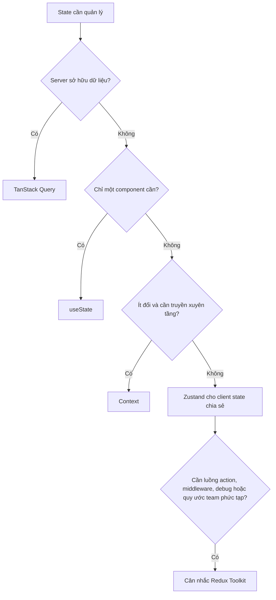

# Module 03 · Ngày 9

## Client state với Zustand & bức tranh state management

### 📚 Lý thuyết

#### Vì sao cần một store client nhẹ

Khi client state cần chia sẻ giữa nhiều component xa nhau (giỏ hàng, bộ lọc toàn cục, trạng thái UI phức tạp), useState + props/context bắt đầu đuối. Zustand cung cấp store ngoài cây React, đăng ký bằng selector — component chỉ re-render khi phần dữ liệu nó chọn đổi (khác bẫy re-render của Context).

#### Zustand cơ bản

create một store với state + action; dùng selector useStore(s => s.value). Không cần Provider. Hiểu vì sao selector giúp tránh re-render thừa.

#### Khi nào Redux, khi nào không

Trả lời cho câu hỏi thường gặp:

- Không cần store toàn cục nếu phần lớn state là server state (→ TanStack Query) hoặc cục bộ (→ useState).
- Zustand đủ cho hầu hết nhu cầu client state chia sẻ, ít boilerplate.
- Redux Toolkit hợp khi cần: luồng dữ liệu rất phức tạp, cần time-travel debug, middleware mạnh, hoặc team đã chuẩn hoá theo Redux. Hiểu rằng Redux không "lỗi thời" — nó giải bài toán khác, ở quy mô khác.

#### Nguyên tắc chọn

Bắt đầu nhỏ: useState → nâng lên context cho dữ liệu ít đổi → Zustand cho client state chia sẻ → TanStack Query cho mọi thứ từ server. Đừng đặt server state vào store client.

### 🛠️ Thực hành

- Dựng một Zustand store cho bộ lọc (tag đang chọn, từ khoá search); đăng ký bằng selector.
- Quan sát chỉ component đọc đúng slice mới re-render.
- Vẽ sơ đồ quyết định "loại state này nên ở đâu" cho 5 ví dụ state khác nhau.

### 🚀 Đóng góp vào DevBlog

Chuyển trạng thái bộ lọc (tag + từ khoá) sang Zustand store useFilterStore. PostList đọc selector để lấy filter và truyền vào queryKey của TanStack Query — phối hợp client state (filter) với server state (posts). Theme có thể giữ ở Context hoặc chuyển sang store tuỳ người học.

### ✅ Kết quả đạt được

- Dùng Zustand với selector, hiểu vì sao tránh re-render thừa.
- Trình bày được cây quyết định chọn nơi đặt state.
- Trả lời rõ ràng "khi nào Redux".
- DevBlog tách bạch filter (client) và posts (server) đúng tầng.

### 🔗 Tham khảo

- [Zustand — Docs](https://zustand.docs.pmnd.rs/)
- [Zustand — GitHub](https://github.com/pmndrs/zustand)
- [Redux Toolkit — When should I use Redux](https://redux-toolkit.js.org/usage/usage-guide)
- [TanStack Query — Does this replace global state](https://tanstack.com/query/latest/docs/framework/react/guides/does-this-replace-client-state)

### Đọc và thực hành trên `/day-9`

#### 1. Store chỉ giữ client state

Đọc `web/stores/filter-store.ts`. `create<FilterState>()` tạo hook store không cần Provider. State có `tag`, `query`; action có `setTag`, `setQuery`, `resetFilters`. `set({ tag })` merge phần được cập nhật, không xóa query hoặc các action. Không đặt posts/likes vào đây: các dữ liệu đó vẫn thuộc TanStack Query.

Store này giữ bộ lọc trong phiên client khi điều hướng, không persist qua reload. Chỉ sửa store trong sự kiện client; không đọc/ghi store trong Server Components. Đây là demo giá trị mặc định cố định. App cần khởi tạo store từ dữ liệu SSR riêng từng request nên dùng store factory và Provider theo request, tránh dùng singleton server cho dữ liệu của người dùng.

#### 2. Selector và tham chiếu

Đọc `web/components/post-filters.tsx`, `web/app/day-9/filter-summary.tsx`, `selector-demo.tsx`.

```tsx
const tag = useFilterStore((state) => state.tag);
const setTag = useFilterStore((state) => state.setTag);
```

Component đăng ký giá trị selector trả về. Nếu giá trị đó không đổi theo Object.is, cập nhật store khác không bắt component render lại. Component vẫn có thể render vì props, state riêng hoặc Context nó đọc đổi; selector không thay thế memo cho mọi nguyên nhân render.

Nếu selector tạo object mới, dùng useShallow hoặc tách selector:

```tsx
const { tag, query } = useFilterStore(
  useShallow((state) => ({ tag: state.tag, query: state.query })),
);
```

Không viết selector tạo object mới mỗi lần mà không ổn định kết quả trong Zustand v5; có thể tạo cập nhật lặp. useShallow so sánh nông các thuộc tính, không phải so sánh sâu mọi object lồng nhau.

Mở console rồi thử:

- Gõ từ khóa: QueryReader và CombinedReader cập nhật; TagReader và ActionReader không cập nhật do store.
- Đổi tag: TagReader và CombinedReader cập nhật; QueryReader không cập nhật do store.
- Đặt lại cùng giá trị: các selector tương ứng không có render mới.
- Bấm State cha: các reader bọc memo không render lại vì props không đổi.
- Reset: reader có dữ liệu thực sự đổi sẽ cập nhật. ActionReader đọc hàm reset có tham chiếu ổn định.
- Strict Mode có thể lặp log trong môi trường dev; quan sát log mới theo thao tác thay vì đếm tuyệt đối.

#### 3. Filter → queryKey → API

Đọc `web/hooks/use-filtered-posts.ts`, `web/lib/posts-query.ts`, `api/post-filters.ts`, `web/app/api/posts/route.ts`, `web/components/post-list.tsx`.

```text
PostFilters cập nhật Zustand
  → useFilteredPosts đọc tag/query bằng selector
  → debounce query 300 ms
  → chuẩn hóa filter
  → key ['posts', 'list', { tag, query }]
  → GET /api/posts?tag=...&query=...
  → server lọc posts
  → TanStack Query lưu kết quả theo key
  → PostList hiển thị
```

Key và URL dùng cùng filter chuẩn hóa, tránh gắn kết quả request vào cache sai. Tag/query khác có cache riêng. Chuyển về filter đã dùng trong 30 giây có thể đọc cache ngay. Khi query đang gõ đổi, input cập nhật ngay; debounce chỉ tác động đến key/request, không làm input chậm.

Danh sách đầy đủ vẫn dùng key `['posts']` cho tổng số và options tag. Options không lấy từ danh sách đã lọc để tránh mất lựa chọn tag. InitialData của Day 7 chỉ khởi tạo cache đầy đủ, không giả làm dữ liệu cho một bộ lọc khác.

Shared PostList hiện dùng Zustand và lọc server; demo useTransition ở Day 7 vẫn giữ riêng. Không dùng startTransition để hứa rằng cập nhật external store sẽ trở thành render nền: external store và React state có cơ chế khác nhau.

#### 4. Cache theo bộ lọc và mutation

Đọc `web/lib/post-cache.ts`, `web/hooks/use-post-mutations.ts`.

Day 8 có một cache posts chính; Day 9 có thêm nhiều cache filtered list. Cập nhật chỉ key `['posts']` sẽ không làm số like trong danh sách đang lọc tăng ngay. Vì vậy:

- Snapshot các query bắt đầu bằng `['posts']` sau cancelQueries.
- Like cập nhật bài có cùng ID trong mọi cache đã có dữ liệu.
- Thêm bài tạm chỉ vào cache có bộ lọc phù hợp. Bài thêm có tag react; khi đang lọc nextjs, bài đó không xuất hiện là đúng.
- Success thay bài tạm/dữ liệu cũ bằng dữ liệu server và invalidate theo prefix để refetch các query active.
- Error phục hồi từng snapshot về đúng queryKey.
- UI vẫn khóa thao tác ghi khác trong lúc mutation pending, vì rollback snapshot toàn danh sách chưa giải quyết mutation đồng thời.

Thử chọn react, bấm like rồi giả lập lỗi: card đang lọc và tổng like cùng tăng tạm/cùng rollback. Thử thêm bài khi lọc react, nextjs và từ khóa có/không khớp. Sửa tiêu đề rồi refetch có thể làm bài rời danh sách nếu không còn khớp từ khóa.

#### 5. Chọn nơi giữ state

Đọc `web/app/day-9/state-decision-demo.tsx`. Tự chọn cho năm ví dụ trước khi mở đáp án.



Đây là gợi ý chọn công cụ, không phải chuỗi nâng cấp bắt buộc. Redux không lỗi thời; phù hợp khi cần kiểm soát lịch sử action/state, middleware và quy ước cập nhật rõ ràng trong nhóm. Time-travel debug không tự tạo tính năng undo/redo cho sản phẩm; tính năng đó vẫn cần thiết kế riêng. Không bắt buộc đưa mọi state vào global store.

### Các file hỗ trợ

- `web/app/day-9/page.tsx`: ghép các demo; tái sử dụng form thêm bài và summary Day 8.
- `day-9.css`: bố cục và bảng bài tập.
- `web/package.json`, `package-lock.json`: thêm Zustand v5.
- Theme giữ Context tối ưu của Day 6 vì đó là một lựa chọn phù hợp với mục tiêu bài.

### Điểm cần tự giải thích sau khi chạy

1. Vì sao thay query không bắt TagReader render lại từ store?
2. Vì sao object selector cần useShallow còn string selector thường không cần?
3. Vì sao filter phải có trong queryKey lẫn URL request?
4. Vì sao sửa cache đầy đủ chưa đủ cho optimistic like ở danh sách đang lọc?
5. Vì sao không đưa posts vào Zustand, và trường hợp nào đáng cân nhắc Redux Toolkit?
