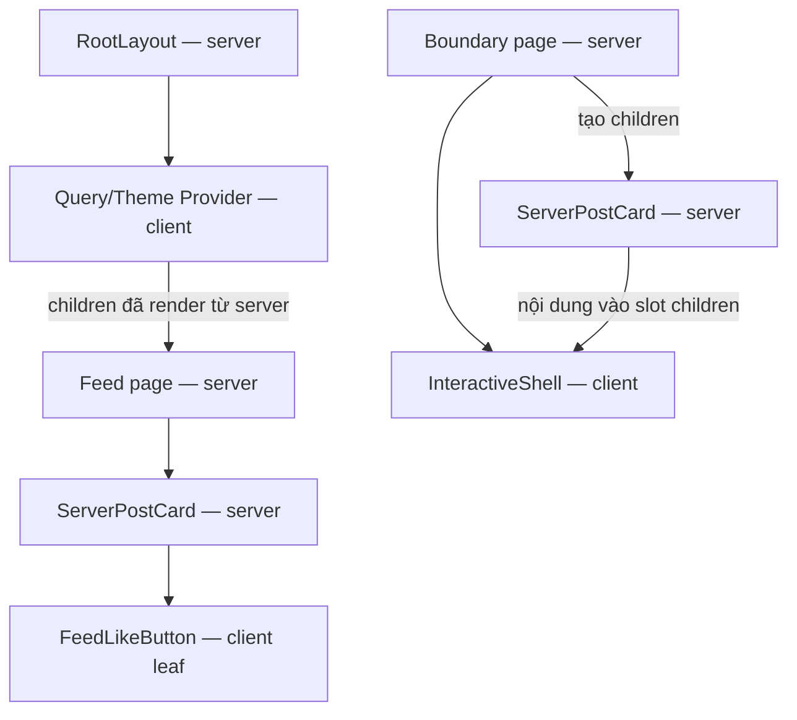

# Module 04 · Ngày 10

## App Router & React Server Components

### 📚 Lý thuyết

#### Mô hình RSC

Trong App Router, page/layout mặc định là Server Component. Module nằm trong đồ thị import của Client Component thuộc client boundary. Server Component chạy trên server, mã component không gửi xuống client; có thể truy cập dữ liệu (DB, fs, env bí mật). Kết quả render và props truyền sang client vẫn được gửi xuống browser, nên không đưa giá trị bí mật vào chúng. Chỉ khi cần tương tác (state, effect, event handler, browser API) mới đánh dấu 'use client' để biến thành Client Component.

#### Ranh giới server/client

Hiểu "client boundary": một khi 'use client', mọi component import vào nó cũng thành client. Mẹo kiến trúc quan trọng: giữ Client Component ở lá của cây, truyền Server Component vào qua children/props để giảm JS xuống client. Server Component có thể render Client Component. Client Component không import trực tiếp Server Component để chạy logic server; có thể nhận nội dung server đã render qua children/props. Props qua boundary cần React-serializable. Client Component cũng có thể được prerender thành HTML trên server trong lần tải đầu, rồi hydrate để tương tác; use client không có nghĩa chỉ chạy trên browser.

#### Quy ước file

layout.tsx (bọc, giữ qua điều hướng), page.tsx, loading.tsx (Suspense fallback tự động), error.tsx (error boundary), not-found.tsx, nested layouts. Hiểu vì sao root layout bắt buộc có <html>/<body>.

#### Data fetching trong RSC

Fetch ngay trong Server Component bằng async/await — không cần useEffect. Đây là lý do nhiều logic data ở Module 03 chuyển lên server.

### 🛠️ Thực hành

- Tạo app Next 16 mới (create-next-app), khám phá cấu trúc app/.
- Tạo một Server Component fetch dữ liệu giả trực tiếp; thêm loading.tsx và error.tsx.
- Tạo một Client Component nhỏ ('use client') cho một nút tương tác; quan sát ranh giới client trên React DevTools.
- Refactor: đẩy 'use client' xuống lá, giữ phần tĩnh ở server.

### 🚀 Đóng góp vào DevBlog

Khởi tạo phiên bản App Router của DevBlog. Trang feed (app/page.tsx) là Server Component fetch danh sách bài. PostCard phần tĩnh là server, nút Like ('use client') là lá. Thêm loading.tsx cho feed.

### ✅ Kết quả đạt được

- Giải thích RSC và phân biệt server vs client component.
- Vẽ được client boundary và biết cách thu nhỏ nó.
- Dùng quy ước file (layout/loading/error) đúng.
- DevBlog feed chạy trên Server Component + loading state.

### 🔗 Tham khảo

- [Next.js — Server and Client Components](https://nextjs.org/docs/app/getting-started/server-and-client-components)
- [Next.js — Layouts and Pages](https://nextjs.org/docs/app/getting-started/layouts-and-pages)
- [Next.js — Fetching Data](https://nextjs.org/docs/app/getting-started/fetching-data)
- [React — Server Components](https://react.dev/reference/rsc/server-components)

### Nền dự án và bài thực hành

`web/` đã được tạo bằng create-next-app ở module trước và đang dùng Next 16 App Router. Bài này dùng tiếp scaffold đó: đọc package.json, app/layout.tsx, page.tsx, globals.css và next.config.ts để hiểu cấu trúc. Nếu muốn lặp lại bước tạo project riêng, chạy từ thư mục thử nghiệm:

```bash
npx create-next-app@16 router-lab --ts --eslint --app --use-npm
```

Không cần chạy lệnh trên trong repo đang học. Các bài mới nằm ở `/day-10`, còn `/` trở thành feed RSC của DevBlog. Các demo Day 4–9 vẫn còn.

### Đọc file theo luồng chạy

1. **`web/lib/server-posts.ts`**: import server-only để Next báo lỗi nếu bị import vào client bundle. `getServerPosts` dùng connection để đọc theo request, giả lập delay 900 ms rồi gọi fetchPosts trực tiếp; không fetch vòng qua route của chính app. `getServerFacts` đọc package.json bằng node:fs để minh họa khả năng chỉ có ở server. Chỉ version công khai được trả về UI, không có secret.
2. **`web/app/page.tsx`**: async Server Component. Await dữ liệu, map ServerPostCard; không useEffect/useState và không có use client. SearchParams là Promise trong Next 16, được await để đọc fail=1.
3. **`web/components/server-post-card.tsx`**: phần tiêu đề, nội dung, tác giả và tag render trên server. Component có server-only guard. Truyền chỉ postId và số like xuống FeedLikeButton; không truyền callback thường qua boundary.
4. **`web/components/feed-like-button.tsx`**: client leaf dùng state/event handler và HTTP API của Day 8. Tăng tạm số like, giữ kết quả khi thành công hoặc rollback khi lỗi. Đồng bộ Query cache của các bài trước, rồi router.refresh để đọc lại RSC. Đây chưa phải Server Action (bài sau). Props từ server mới được đồng bộ vào local state bằng điều kiện có guard; không đặt setState loading trực tiếp trong effect.
5. **`web/app/loading.tsx`**: Next tự tạo Suspense boundary cho page phía dưới; skeleton xuất hiện trong lúc page chờ dữ liệu. Layout phía ngoài có thể vẫn hiển thị. Delay chỉ để học streaming, không phải pattern cần giữ trong production.
6. **`web/app/error.tsx`** và **`web/components/route-error.tsx`**: error boundary phải là Client Component. Effect ghi lỗi ra console; UI không hiển thị raw error vì production có thể che thông tin server. Nút reset thử lại render; nếu URL vẫn fail=1 thì lỗi vẫn xảy ra. Link về feed bỏ tham số lỗi.
7. **`web/app/not-found.tsx`**: fallback trang không tồn tại. Trong route chi tiết, notFound() là điều khiển luồng đặc biệt, không phải lỗi tải API để catch chung.
8. **`web/app/layout.tsx`**: giữ html/body và providers cũ, đổi metadata/locale cho DevBlog. Dù QueryProvider/ThemeProvider là client, children được tạo từ server vẫn là nội dung server; boundary được quyết định bởi import graph, không chỉ bởi vị trí JSX.
9. **`web/app/day-10/layout.tsx`** và **`layout-counter.tsx`**: nested layout có navigation server và một counter client nhỏ. Không tạo html/body lần nữa. Counter được giữ khi điều hướng trong segment day-10; rời segment hoặc reload có thể reset.
10. **`web/app/day-10/page.tsx`**: dùng Promise.all đọc posts và facts; minh họa async/await ở server và I/O node:fs. Có link giả lập lỗi và thử not-found.
11. **`web/app/day-10/loading.tsx`**, **`error.tsx`**, **`not-found.tsx`**: boundary theo segment, dùng giao diện phù hợp bài học. error không bắt lỗi ở layout cùng segment; lỗi layout cần boundary từ segment cha.
12. **`web/app/day-10/posts/[id]/page.tsx`**: await params, kiểm tra ID, tìm bài trên server; gọi notFound khi ID sai hoặc không có bài.
13. **`web/app/day-10/wide-client-card.tsx`**: bản trước refactor, cả phần tĩnh và nút tương tác cùng nằm trong client module. Like ở đây chỉ là state local để quan sát boundary, không ghi server.
14. **`web/app/day-10/boundary/page.tsx`**: đặt bản client rộng cạnh ServerPostCard có client leaf. Trang server là nơi import và ghép hai loại component.
15. **`web/app/day-10/interactive-shell.tsx`**: client wrapper có nút ẩn/hiện, nhận children nhưng không import ServerPostCard. Server Component cha truyền card vào slot children; nút ẩn không làm logic server tự chạy lại.
16. **CSS**: page.module.css cho feed, server-post-card.module.css cho card, day-10.css cho trang học. Package files thêm server-only; dependency chỉ là marker bảo vệ boundary, không tự biến code thành API.

### Client boundary



Sơ đồ là quan hệ composition, không có nghĩa Provider import feed hoặc InteractiveShell import ServerPostCard. use client kéo các module import xuống client graph; nội dung server truyền qua children là trường hợp khác.

### Chạy và quan sát

- Mở `/`: skeleton xuất hiện trước rồi feed. Console terminal có `[RSC] Đọc posts...` và `[RSC] ServerPostCard...`; bấm Like, số tăng ngay và server được ghi sau độ trễ. Reload xác nhận số đã lưu trong store mock.
- Bật giả lập lỗi Like: số tăng tạm rồi rollback. Lỗi event handler được xử lý tại nút, không tự rơi vào error.tsx.
- Mở `/?fail=1` hoặc `/day-10?fail=1`: thử route error. Bấm Thử lại vẫn lỗi vì URL cố tình yêu cầu lỗi; link Về feed dùng navigation đầy đủ để mở URL sạch và reset cả error boundary.
- Mở `/day-10/posts/1`: chi tiết bài. Mở `/day-10/posts/999999` hoặc ID không hợp lệ: not-found của segment. Response streamed có thể đã trả status 200 trước khi phát hiện not-found; kiểm tra UI/noindex thay vì chỉ status.
- Trong `/day-10`, tăng layout counter rồi qua Client boundary và quay lại bằng Link: counter được giữ. Reload để so sánh.
- Trong Client boundary, so sánh WideClientCard với ServerPostCard. Với React DevTools phiên bản hỗ trợ RSC, quan sát component client tương tác; Server Components có thể được hiển thị khác nhau theo phiên bản công cụ. Không kết luận boundary từ việc card có xuất hiện trên cây DOM hay không.
- Mở Network/Sources: HTML có nội dung server; các module client vẫn có JS để hydrate. Có thể kiểm tra client-reference manifest của production build: FeedLikeButton có client reference, ServerPostCard không có module client reference.
- Bấm ẩn/hiện trong InteractiveShell. Nội dung server được truyền qua children, không cần đưa toàn card vào client graph.
- Không thử import server-posts hoặc ServerPostCard vào Client Component đang chạy. Nếu muốn kiểm chứng guard, thử trên nhánh riêng rồi bỏ thay đổi: build sẽ báo server-only module bị import vào client.

### Kiến thức cần chốt

- RSC không có nghĩa toàn bộ trang không còn JS: client leaves và providers vẫn cần JS. Mã Server Component không đi vào client bundle, nhưng HTML/RSC output và props vẫn có thể chứa dữ liệu được render.
- Client Component có thể prerender trên server, nên không đọc window/localStorage ở module scope hoặc render mà chưa xử lý môi trường. Browser APIs thường đặt trong effect hoặc event handler.
- RSC thích hợp đọc dữ liệu cho render; React Query vẫn hữu ích cho server state tương tác, cache client và refetch. Chọn theo nhu cầu, không bắt buộc chuyển mọi query lên RSC.
- Feed đọc mock store process của Day 8. Restart mất dữ liệu; nhiều process/serverless không chia sẻ bộ nhớ. Connection phục vụ demo đọc theo request, chưa triển khai chính sách cache production (bài sau).
- Sau khi đọc, hãy giải thích: vì sao RootLayout vẫn là server dù bọc client Provider; vì sao card truyền vào children vẫn ở server; và khác biệt giữa loading.tsx, error.tsx, not-found.tsx.
